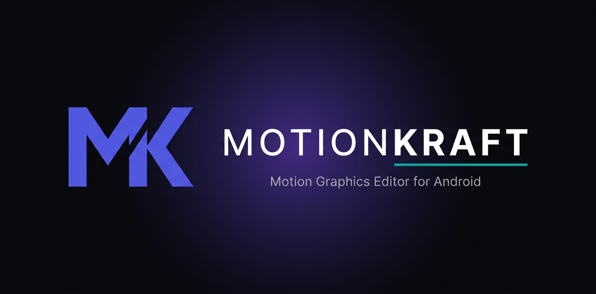

# MotionKraft

Motion graphics and video editor for Android. Targets short-form creators who need keyframe-based compositing, beat-synced effects, and export control that goes beyond the standard one-tap editors.

This repository contains the application source, signing configuration (keystore held in GitHub Secrets, never committed), and the release pipeline that produces signed APK and AAB artifacts via GitHub Actions.

Repository: [https://github.com/xykal/MotionKraft](https://github.com/xykal/MotionKraft)

---

## Status

Working editor: multi-track timeline, keyframed transforms, jedag-jedug presets, colour and effects, text layers, and FFmpeg export to H.264 and AAC. Projects are saved on the device.

Not yet implemented: undo and redo, audio waveforms, custom fonts, and animated opacity in exports (opacity keyframes are preview-only).

Minimum Android: 8.0 (API 26)
Target SDK: 34
Architectures: arm64-v8a, armeabi-v7a

---

## Features

### Timeline
- Video, photo, and text clips on stacked tracks
- Tap a clip to select it, drag it to move it, tap or drag the ruler to scrub
- Split at the playhead, duplicate, delete
- Speed from 0.5x to 2x (audio follows the speed)

### Transform and Motion
- Position, scale, rotation, and opacity, stored as keyframes
- Jedag-jedug presets (zoom punch, heavy shake, pulse, earthquake, whip pan, spin, RGB glitch) generate keyframes from BPM and intensity, and stay editable
- Preview and export use the same timing rules. Bounce and elastic easings export as linear.

### Look
- Brightness, contrast, saturation, volume
- Effects: vintage, black and white, cinematic, blur, RGB glitch

### Text
- Text layers with size, colour, and outline

### Export
- Canvas size is chosen on the start screen (9:16, 16:9, or 1:1)
- H.264 video, AAC audio, runs as a foreground service with progress and cancel
- Saved to `Movies/MotionKraft` and added to the gallery

---

## Project Structure

```
app/
  src/main/
    java/xyz/xyverse/motionkraft/
      data/model/         Timeline, Clip, Keyframe, Effect, Transform
      editor/             FFmpeg command builder, export service
      effects/            Jedag-jedug preset keyframe generators
      presentation/       ViewModel and Jetpack Compose UI
      ui/theme/           Material 3 dark theme
    res/                  Drawables, values, manifest, adaptive icon
  build.gradle.kts
  proguard-rules.pro

.github/workflows/        CI/CD build pipeline
branding/                 Icon source and README banner
```

---

## Building

### Prerequisites
- Android Studio Hedgehog or newer
- JDK 17
- Android SDK with platform 34 and NDK (for ffmpeg-kit native libraries)

### Debug Build
```
./gradlew assembleDebug
```
Output: `app/build/outputs/apk/debug/app-debug.apk`

### Release Build (Local)
1. Place the release keystore at `keystore/motionkraft-release.jks` (this path is gitignored).
2. Provide signing credentials via environment variables or `~/.gradle/gradle.properties`:
   ```
   SIGNING_STORE_PASSWORD=...
   SIGNING_KEY_PASSWORD=...
   SIGNING_KEY_ALIAS=motionkraft
   ```
3. Run:
   ```
   ./gradlew assembleRelease bundleRelease
   ```
   App bundles are produced in `app/build/outputs/bundle/release/`.

---

## Continuous Integration and Release Pipeline

GitHub Actions workflow at `.github/workflows/android-build.yml` runs on push, tag, pull request, and manual dispatch.

Two jobs:

1. **build-debug** runs on every push and pull request. It has no access to signing material and produces an unsigned debug APK.
2. **build-release** runs only on version tags (`v*`) or when manually dispatched with `buildType=release`. It requires the `production` GitHub Environment, which is configured with:
   - Required reviewer: `xykal` only
   - Deployment restricted to `main` and tags `v*`
   - All signing material held exclusively as environment secrets

Release secrets scoped to the `production` environment:

| Secret | Purpose |
|---|---|
| `SIGNING_KEYSTORE_BASE64` | Base64-encoded PKCS12 release keystore |
| `SIGNING_STORE_PASSWORD` | Keystore password |
| `SIGNING_KEY_PASSWORD` | Key password |
| `SIGNING_KEY_ALIAS` | Key alias (`motionkraft`) |

The workflow decodes the keystore at job start, verifies it with `keytool`, runs R8 and resource shrinking, builds signed APK and AAB, computes SHA-256 checksums, and uploads artifacts. Tag builds additionally create a draft GitHub Release.

Pull requests from forks never receive release secrets. Dependabot is enabled for weekly dependency updates. TruffleHog runs on every push to detect leaked credentials.

---

## Security Model

- The release keystore is never committed. It exists only as a base64-encoded GitHub environment secret.
- Release builds require manual reviewer approval before any job with access to signing material is allowed to run.
- Fork PRs run in a stripped-down job with no access to repository secrets.
- The workflow `permissions:` block restricts the default `GITHUB_TOKEN` scope.
- Release checkouts use `persist-credentials: false` to prevent third-party steps from inheriting the token.
- R8 obfuscation and class repackaging are enabled for release builds. All `Log.v`/`Log.d`/`Log.i` calls are stripped by ProGuard.
- Cleartext traffic is blocked via network security config.
- The `CODEOWNERS` file enforces owner review on changes to workflows, build scripts, and ProGuard rules.
- Actions allowlist is restricted to the specific versions used in the workflow.
- Branch protection on `main` requires one approving review, passing CI, linear history, and blocks force pushes and deletions.

---

## APK Integrity

Release builds are signed with a 4096-bit RSA key valid for 27 years. The signing certificate SHA-256 fingerprint will be published alongside the first public release so end users can independently verify APK provenance.

Each release job publishes a `sha256sums.txt` next to the APK and AAB.

---

## Roadmap

Priority order:

1. Real-time OpenGL preview pipeline so effects and transforms render live while scrubbing
2. Bezier curve editor for keyframe interpolation
3. Masking and track matte layers
4. Chroma key
5. Beat detection from audio for automatic BPM-locked jedag-jedug
6. Per-transform motion blur
7. Audio waveform, ducking, voice-over
8. Custom font loading and per-text animation presets
9. Clip-to-clip transition library (slide, zoom, morph, glitch)
10. AI-assisted captions and shot detection
11. Versioned project save/load

---

## License

Copyright (c) 2026 XyVerse. All rights reserved.

This source is published publicly for visibility and distribution. No permission is granted to reproduce, modify, distribute, sublicense, or sell any part of this software without explicit written permission from the copyright holder.

THE SOFTWARE IS PROVIDED "AS IS", WITHOUT WARRANTY OF ANY KIND.

---

## Repository Owner

xykal
